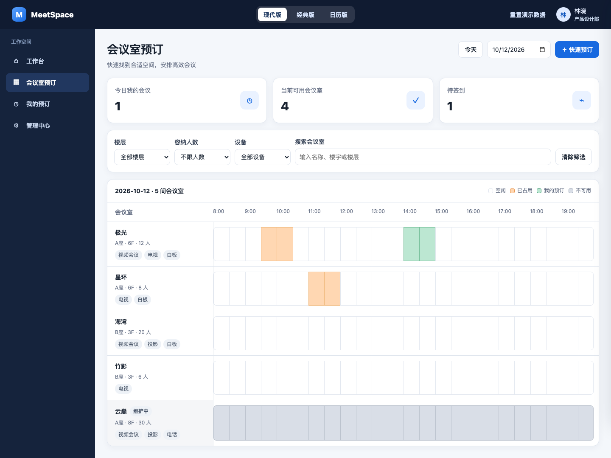

# MeetSpace · 会议邀约平台

基于 **Ant Design Pro（Umi Max v4 + antd v6 + ProComponents v3）** 的会议室预订 / 会议邀约项目。



> 效果图见 `Desktop/meet` 下的设计稿图片。

## 功能

| 模块 | 说明 |
| --- | --- |
| 登录 | **免密演示登录**（用户信息实时取自用户中心）+ 账号密码登录（换发 access/refresh 双令牌） |
| 工作台 | 问候区、今日会议 / 待签到 / 可用会议室统计、今日日程、会议室速览、快捷入口 |
| 会议室预订 | 三种视图：**现代版**（横向时间轴 8:00-20:00）、**经典版**（列表 + 当日日程条）、**日历版**（按月）；楼层 / 人数 / 设备 / 关键词筛选；一键快速预订（含冲突检测） |
| 我的预订 | 我的会议列表、状态筛选、签到 / 取消 / 详情 |
| 管理中心 | 会议室管理（增删改）、预订管理（按日期）、成员花名册（接入用户中心开放接口） |

数据存储分两级：**线上**走服务器 MySQL（新建 `meetspace` 库 + `meetspace-api` 数据服务，多人共享、跨端实时同步），接口不可用或本地开发时自动回退 `localStorage` 演示数据。顶栏「**重置演示数据**」随时恢复初始种子数据（线上 = 重新播种数据库）。

## 快速开始

要求 **Node ≥ 22**（见 `CLAUDE.md`）。

```bash
npm install
npm run dev        # 开发：http://localhost:8000 （MOCK=none，走 dev 代理）
npm run build      # 生产构建
npm run lint       # Biome + tsc
```

演示登录选择任一用户即可进入；`ID 1`（管理员）可看到「管理中心」。

## 用户中心接入

接口文档：<http://47.99.54.0:8080/docs/open-api.html>

- 封装在 `src/services/openapi.ts`，凭据配置在 `src/config.ts`
- 支持两条通道：`api_key`（X-Api-Key 直传，默认）/ `sign`（HMAC-SHA256 签名，密钥不出网），改 `OPEN_AUTH_MODE` 即可切换
- 前端统一请求同源 `/api/open`：开发走 `config/proxy.ts` 的 dev 代理，生产部署由 nginx 反代到网关 `127.0.0.1:8080`（网关有 Origin 白名单，不可在前端跨域直连 `OPEN_API_ORIGIN`）
- 用到的接口：

| 接口 | 用途 |
| --- | --- |
| `GET /api/open/users?id=` | 演示登录拉取真实用户 / 花名册 |
| `POST /api/open/auth/login` | 账号密码登录，换 access(15min)/refresh(15d) 双令牌 |
| `POST /api/open/auth/verify` / `refresh` | 会话保鲜：过期自动轮换令牌（`src/services/auth.ts`） |

> 会议室与预订数据由本项目自建的数据服务维护（用户中心只开放用户能力，见下节）。

## 数据服务（MySQL）

线上部署使用服务器自带的 MySQL 8（`stack-mysql` 容器）新建 **`meetspace`** 库（`rooms` / `bookings` 两表 + 种子数据），由 **`meetspace-api`** 服务（Node 20 + Express，systemd 常驻 `127.0.0.1:8088`，代码在服务器 `/opt/meetspace-api/`）提供 REST 接口，nginx 同源反代 `/api/meet/` → 8088：

| 接口 | 用途 |
| --- | --- |
| `GET /api/meet/rooms` | 会议室列表 |
| `POST` `PATCH` `DELETE /api/meet/rooms/:id` | 会议室增改删（管理中心） |
| `GET /api/meet/bookings?from=&to=` | 日期区间预订查询 |
| `POST /api/meet/bookings` | 新建预订（服务端做 SQL 冲突检测，冲突返回 409） |
| `PATCH` `DELETE /api/meet/bookings/:id` | 签到 / 取消 / 删除 |
| `POST /api/meet/reset` | 重置演示数据（重新播种） |

- 前端 `src/store/meetStore.ts` 首帧后拉取服务端数据并每 30s 轮询，写操作乐观更新 + 异步落库；服务端不可用时静默回退 localStorage 演示模式（本地开发即此模式）
- 服务端账号：`meetspace`（仅授权 `meetspace` 库）；演示项目，接口本身不做独立鉴权（仅内网 + nginx 同源反代可达），预订人身份由前端随请求携带

## 目录结构

```
config/            路由、代理、布局默认配置
src/
  app.tsx          运行时配置：getInitialState / 布局 / 自定义顶栏
  config.ts        开放接口地址与鉴权凭据
  services/
    openapi.ts     用户中心开放接口（双通道鉴权）
    auth.ts        会话管理：演示登录 / 密码登录 / 令牌刷新
  store/
    meetStore.ts   会议室与预订数据仓库（服务端 /api/meet 优先，localStorage 兜底）
    viewStore.ts   预订页视图切换（现代 / 经典 / 日历）
  components/
    HeaderBar      自定义顶栏：品牌 / 视图切换 / 重置演示数据 / 用户
  pages/
    user/login     登录页
    workspace      工作台
    booking        会议室预订（时间轴 / 列表 / 日历 + 预订弹窗）
    my             我的预订
    admin          管理中心
```
